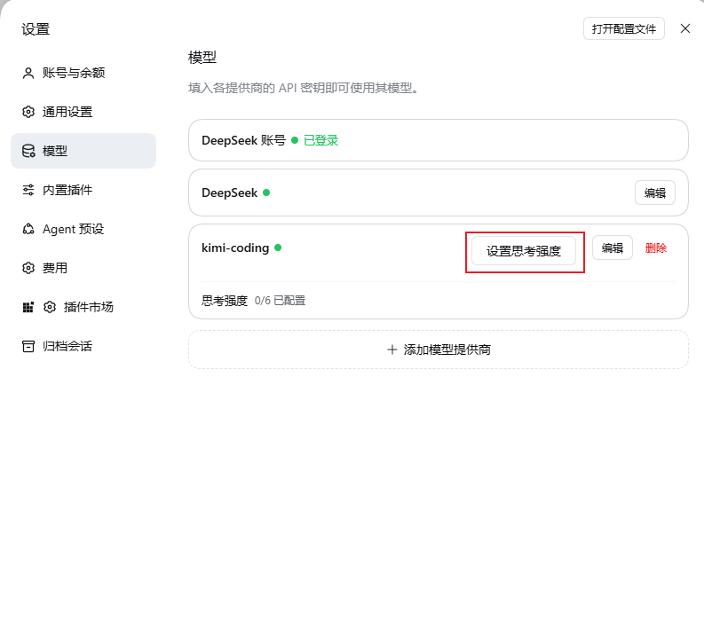
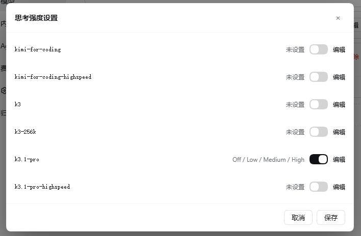

# Online Model Discovery

为 DeepSeek Harness 的内置第三方模型提供商提供三类能力：

1. **在线模型列表发现**：直接向提供商端点请求 `/models`，网络失败时回退到 pi-ai 内置目录；
2. **逐模型思考强度设置**：在不修改 DSH 本体的前提下，为内置目录提供商补齐每个模型的 `reasoningEfforts` 编辑入口；
3. **模型兼容开关补全**：给 pi-ai 目录里没有的型号补上同一提供商、同一协议下所有型号一致的 `compat` 开关，避免退回到 pi-ai 的 OpenAI 默认检测。

## 截图

设置页中的入口：



按模型编辑思考强度：



## 功能

- **在线发现**：对 `llm-pi-ai` 下的提供商请求模型列表，支持 OpenAI 兼容协议与 Anthropic Messages 协议；
- **匿名尝试**：没有 API Key 时先尝试匿名请求，公开端点（如 OpenRouter）可直接使用；
- **元数据补全**：从端点返回中解析上下文窗口、最大输出 token、输入类型与推理档位，并在发现、保存和运行时 `resolveModelInfo` 三处补全；
- **思考强度编辑**：内置目录提供商可按模型开关推理、编辑档位与 API 参数值，保存后写入 provider 配置；
- **兼容补全**：保存模型列表时，目录里查不到的型号会继承该提供商同协议型号一致认同的 `compat` 开关（例如 Kimi 的 `supportsDeveloperRole: false`、`maxTokensField: max_tokens`），目录里已有的型号保持原样；
- **显式关闭**：关闭思考强度写入 `reasoningEfforts: false`，不会被后续保存重新补回；
- **作用域收敛**：自定义模型 API 路由（原生已有推理等级编辑器）与新增提供商草稿卡不显示入口；
- **失败提示**：网络请求失败回退目录时，短暂显示橙色提示。

## 安装

```sh
dsh plugin --profile web add github:DHLlib/online_model_discovery
```

桌面端请在应用内 **设置 → 插件** 中从本地目录或市场安装。

要求：

- DeepSeek Harness `0.2.2-rc.1`（当前验证版本）；
- 提供商通过 `llm-pi-ai` 配置，例如 `kimi-coding`、`openrouter`、`anthropic`；
- 需要在线发现真实模型时，提供商的 `/models` 必须可访问；Kimi Code 等端点需要 API Key。

## 使用

1. 打开 **设置 → 模型**；
2. 在已保存的第三方提供商卡片上点击 **设置思考强度**；
3. 在弹窗中为每个模型打开开关，编辑 `档位 / API 参数值`，点击保存；
4. 模型列表为空时按钮置灰，需先点 **获取可用模型** 并保存模型列表。

> 插件启动时会自动回填已有模型列表里缺失的 `compat`，通常重启 DSH 即可；若宿主无法写配置，重新保存一次模型列表也会补齐。

Kimi Coding 的推荐档位：

| 档位 | API 参数值 |
|---|---|
| low | low |
| high | high |
| max | max |

## 工作方式

- 宿主侧 `index.js` 包装 `llm.discoverModels` 与 `llm.resolveModelInfo`，并暴露本地只读/写入路由；
- 宿主侧通过 `ctx.inject(['settings'], …)` 等 settings 服务就绪后包装 `settings.mutate`：写入 `providers.<p>.models` 或整块 provider 时补齐元数据与 `compat`（直接 `ctx.get('settings')` 在插件 apply 时还拿不到服务，钩子会静默失效）；
- 服务就绪后还会做一次启动回填，把已有模型列表里缺失的 `compat` 写回用户层，避免"升级插件后第一发请求仍然 400"；
- `compat` 从 **pi-ai 自带目录**（`dist/providers/data/<provider>.json`）推导，不是插件里的厂商表：取该提供商、该协议下所有型号声明一致的开关，只写 `dsh-llm-pi-ai` 允许配置的字段；路由级 `compat` 已声明的字段不再重复写到型号上；
- 写入被 DSH 校验拒绝时（例如 DSH 升级收紧了可配置字段），自动退回原始写入，保存不会失败，失败原因可通过 `/online-model-discovery/providers` 的 `catalog.lastCompatFailure` 查看；
- 客户端 `client.js` 只使用官方 `settings.models.provider-card` slot，不做 DOM 注入；
- 提供商配置仍保存在 `llm-pi-ai`，不新增自定义 provider。

## 兼容性与限制

- 仅覆盖通过 pi-ai 添加的第三方提供商；DeepSeek 官方账号不在此范围；
- 端点的 `/models` 不返回推理档位时（例如 Kimi Code），需要在弹窗中手动配置；
- 不同端点的元数据字段不统一，插件只采用显式字段，未识别时保留 pi-ai 目录值；
- `compat` 只能补“同提供商同协议型号一致”的开关；按型号族区分的开关（如 `thinkingFormat`、`requiresReasoningContentOnAssistantMessages`）在目录里本就不一致时不会被猜出来，需要时可在 provider 或型号上手写；
- 读取目录依赖 DSH 安装目录（`DSH_INSTALL_DIR`）；读不到时不补 `compat`，其余功能不受影响，也可用 `ONLINE_MODEL_DISCOVERY_CATALOG_DIR` 指定目录；
- 启动回填只写用户层里已经存在的模型列表，且只在缺少开关时写一次（追加幂等，重启不会重复改写）；
- 不修改 DSH 本体，不依赖私有 API；DSH 升级后如 slot 或 provider 字段变化，可能需要同步适配。

## 开发

```sh
node --check index.js
node --check client.js
npm test
```

`test/catalog-compat.test.mjs` 用一份临时目录的 pi-ai 目录数据验证 compat 补全，不依赖本机安装。

目录：

```
index.js            宿主插件：模型发现、元数据补全、compat 补全、设置读写路由
client.js           客户端插件：提供商卡片入口与思考强度弹窗
test/               宿主侧单元测试
cordis.patch.yml    Loader 插件行
locale/             插件显示名与描述
icon.svg            插件图标
docs/images/        README 截图
```
